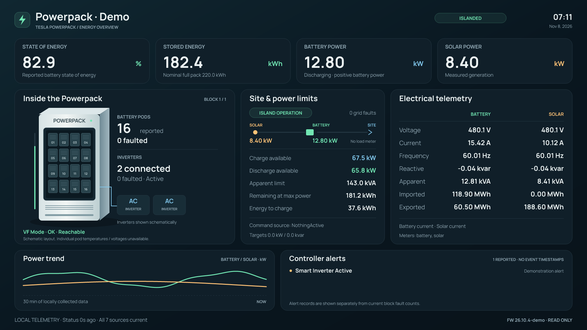

# Homebridge Tesla Powerpack

**`@wcoekaer/homebridge-tesla-powerpack`** gives a Tesla **Powerpack** a local telemetry dashboard camera, native HomeKit battery information, automation sensors, and optional MQTT export. Built on the camera architecture from [homebridge-starlink](https://github.com/wcoekaer/homebridge-starlink).



## Controller access is strictly read-only

The controller client has exactly seven allowlisted HTTPS **GET** paths. It sends no request bodies, follows no redirects, and has no login, POST, PUT, PATCH, DELETE, control, configuration, reboot, or dispatch operations. MQTT is publish-only and cannot send commands back to the Powerpack. Camera playback and snapshots use cached readings; opening Home does not increase controller polling.

The plugin uses the bearer token and site CA certificate supplied by Tesla. Certificate and hostname verification remain enabled. No site certificate, private key, or token is included in the source or npm package. Credential uploads write files only to the Homebridge host.

## Apple Home accessories and battery automations

| Accessory | What it represents |
| --- | --- |
| **Powerpack Battery** | Native `BatteryLevel` (0–100%), `StatusLowBattery`, and `ChargingState`, attached to a contact sensor that opens at the low-battery threshold. Default: opens at ≤15%, closes at ≥20%. |
| **Powerpack Charging** | Contact opens when battery meter power is below −100 W. |
| **Powerpack Discharging** | Contact opens when battery meter power is above +100 W. Both activity sensors close within the ±100 W idle band. |
| **Powerpack At or Below 20 / 50 / 80 Percent** | Configurable battery-level automation contacts. Open at or below the named percentage; close two percentage points above it. |
| **Powerpack Islanded** | Contact opens when the controller reports an islanded state. Islanding can be normal operation. |
| **Powerpack Equipment Fault** | Opens for reported pod/inverter faults, a block fault, or zero available blocks. Alert records are displayed separately and do not automatically assert this sensor. |
| **Powerpack Monitor Unreachable** | Opens when core system status is stale or unavailable. |
| **Powerpack Dashboard** | JPEG snapshots and live encrypted H.264 video of the graphical overview. |

Contacts use **Open = condition active**, **Closed = condition clear**. They are read-only sensors, not switches. Default configuration creates ten accessories. Sensors and threshold contacts can be disabled individually; use an empty `batteryThresholds` array to remove threshold contacts.

HomeKit defines charging versus not charging; it does not have a native discharging value. The two direction contacts make charging, discharging, and idle distinguishable. Battery status uses measured power, never the controller's target-power setpoint.

Apple Home's presentation of battery services varies; the native percentage may appear in accessory details rather than as a standalone battery tile. Apps that expose native battery characteristics can use them in rules. The configurable threshold contacts provide explicit triggers in Apple Home without representing battery level as an unrelated sensor type:

1. In Home, choose **Automation → + → A Sensor Detects Something**.
2. Choose **Powerpack At or Below 20 Percent**, then **Opens**.
3. Choose the scene or other accessories to act on. Use **Closes** for the recovery automation (22% for this threshold).
4. Use **Powerpack Charging / Discharging** in the same way for direction changes.

A home hub is normally required for Home automations and remote access. This plugin exposes no Powerpack controls for those automations to operate.

When data becomes stale, dependent sensors report a communication fault and retain their last contact state. The native battery characteristics become unavailable. A failed read is never interpreted as 0% battery, recovery, or idle.

## Install

Requires Homebridge **1.8+ or 2.x**, Node **22.12+, 24, or 26**, and network access from the Homebridge host to the controller's HTTPS telemetry port (normally **10443**). Development verification uses Homebridge 2.5.

Download the installable `.tgz` from [GitHub Releases](https://github.com/wcoekaer/homebridge-tesla-powerpack/releases), or build an archive from this repository:

```sh
git clone https://github.com/wcoekaer/homebridge-tesla-powerpack.git
cd homebridge-tesla-powerpack
npm ci
npm test
npm pack
```

Install the resulting archive in the Node environment running Homebridge:

```sh
npm install -g /absolute/path/wcoekaer-homebridge-tesla-powerpack-0.1.0.tgz
```

The package is named `@wcoekaer/homebridge-tesla-powerpack`; a GitHub push does not by itself publish it to the npm registry. Once a version is published to npm, it can also be installed by its scoped name.

Live video needs FFmpeg with libx264, MJPEG input, and SRTP. The optional `ffmpeg-for-homebridge` dependency supplies it on supported systems; the plugin otherwise uses `ffmpeg` on PATH, or the configured `camera.ffmpegPath`. JPEG snapshots and sensors work without FFmpeg. When npm asks about dependency install scripts, permit the FFmpeg package's installer if you want its bundled binary.

## Set up a new installation

1. Restart Homebridge and open this plugin's **Settings**.
2. Select the **PEM CA certificate** and **Bearer token file** received from Tesla, then click **Store credentials**. Extensionless files work. Upload both files together when replacing credentials.
3. Enter the **site controller hostname/IP**—for example `192.168.0.49`—and port `10443`.
4. Set the **TLS certificate hostname** to a name included in the controller certificate. For the tested controller this is `localhost`: the TCP connection still goes to the configured controller IP. This reproduces curl's `--resolve localhost:10443:192.168.0.49` behavior without disabling TLS checks.
5. Click **Test telemetry GET**. This makes one authenticated `GET /api/system_status`; it changes no settings on the controller.
6. Set the camera, battery thresholds, and optional MQTT settings. Click **Save**.
7. Use **Set Up Child Bridge** from the plugin menu, let Homebridge assign its identity/port, restart, and pair the child bridge in Apple Home. The camera and sensors pair together.

Uploads are validated and stored under `<Homebridge storage>/tesla-powerpack/credentials-*/`, in a private directory with mode `0700`; files use mode `0600`. Only paths are saved in config.json. The files live outside the plugin install directory and survive upgrades. If Homebridge and its UI run as different users, grant the Homebridge process access to those files. Old uploaded pairs are retained so a canceled settings edit cannot destroy working credentials. Restart the child bridge after changing credentials.

For manual configuration, see [examples/config.json](examples/config.json). Point `tokenFile` and `caFile` to persistent absolute paths on the **Homebridge host**. Files under `/tmp` are suitable for a temporary probe but may disappear on reboot. No credential content belongs in the example configuration.

## MQTT export

Enable **MQTT export** in Settings and enter the broker URL, optional username/password, and a unique topic prefix. Supported URLs are `mqtt://host:1883` and `mqtts://host:8883`. TLS broker certificates use normal system trust or the optional `mqtt.caFile`; verification cannot be disabled. MQTT credentials stay in Homebridge configuration and are never included in telemetry payloads. Configure a separate MQTT broker, not the Powerpack's controller address.

For the default prefix:

| Topic | Payload |
| --- | --- |
| `tesla/powerpack/availability` | `online` or `offline`; retained. Offline on stale controller status, shutdown, or broker Last Will. |
| `tesla/powerpack/state` | JSON summary with units in field names, observed/exported timestamps, battery percentage, direction/health, thresholds, block details, meter values, alerts, and per-endpoint freshness. Stale summary values become `null`. |
| `tesla/powerpack/raw/status` | All fields from system status. |
| `tesla/powerpack/raw/soe` | Reported state of energy. |
| `tesla/powerpack/raw/meters` | All reported meters and their original fields. |
| `tesla/powerpack/raw/grid` | Grid/island state. |
| `tesla/powerpack/raw/gridFaults` | Grid-fault list. |
| `tesla/powerpack/raw/alerts` | Full alert records and diagnostic detail. |
| `tesla/powerpack/raw/site` | Site/controller metadata and firmware. |

Each raw payload contains `endpoint`, `fresh`, `observedAt`, `error`, and `data`. Raw data preserves the last response even when stale; always check its freshness/timestamp. Device IDs and site metadata are included in raw export. Disable **Export all raw telemetry fields** to export only the normalized summary and availability. The normalized block details also contain block identifiers.

Telemetry uses QoS 0 and is retained by default. Publishing occurs on a polling revision or freshness/state transition, with only the latest view kept during disconnection. There is no unbounded offline queue, subscription, command topic, or Home Assistant discovery. The broker reconnects automatically; broker failure does not stop controller polling or HomeKit. Disabling raw export or changing a topic prefix does not delete older retained messages; manage those in your broker if required.

## Dashboard and telemetry semantics

The one-page 1920×1080 dashboard includes energy percentage and remaining capacity, actual battery/solar power, a Powerpack cabinet cutaway, pod/inverter counts, current equipment states, power/energy limits, voltage/current/frequency/reactive/apparent power, imported/exported energy, controller alerts, firmware, and local history. The camera supports 1080p and lower HomeKit resolutions, with cached images and low-rate frame generation. It supports snapshots and live streaming, not HomeKit Secure Video, microphone audio, or Matter camera bridging. No dashboard HTTP listener is opened.

The cabinet depicts the **first reported block** and labels the block count. All blocks and all raw fields are available through MQTT and `probe --json`. Pod slots and inverter boxes are schematic: the verified API exposes aggregate reported/faulted counts, not individual cell voltages, temperatures, or per-pod health. The plugin never invents those values. The tested token receives HTTP 403 for lower-level device vitals; that endpoint is not in the client allowlist.

Power is in watts, energy in watt-hours; the dashboard converts to kW, kWh, or MWh. Positive battery power is discharge/export and negative is charge/import. Available power limits are capabilities at that moment, not measured power. Unreported site/grid/load meters are not estimated. Extreme sentinel values are treated as unknown. Alert records without event timestamps are not labeled as new events or automatically treated as current equipment failures.

The default poll delay is 15 seconds after the preceding cycle finishes; requests run sequentially and never overlap. Each read has a five-second total timeout and 2 MiB response cap. Site metadata refreshes every five minutes. Status becomes stale after 90 seconds; each endpoint retains its own last-success timestamp, and meter freshness also checks the controller's embedded communication time/timeout. Local power history is kept in memory for up to an hour and resets when Homebridge restarts; it is not historical data retrieved from the controller.

The allowlisted endpoints, verified with a Powerpack industrial controller running firmware 26.10.4, are:

```
GET /api/system_status
GET /api/system_status/soe
GET /api/meters/aggregates
GET /api/system_status/grid_status
GET /api/system_status/grid_faults
GET /api/alerts
GET /api/site_info
```

## Preview and diagnose

Render the synthetic preview without contacting a controller:

```sh
npm run preview -- --demo
```

Read a real controller and render one snapshot:

```sh
npm run preview -- --host 192.168.0.49 \
  --token-file /absolute/path/token --ca-file /absolute/path/ca.pem \
  --output artifacts/dashboard-live.png
```

`npm run probe -- --host ... --token-file ... --ca-file ...` prints a compact summary. Add `--json` for full raw telemetry, including site/device identifiers. Neither command publishes to MQTT. `--port` and `--servername` override the HTTPS connection settings. Preview files go to the ignored `artifacts/` directory by default; only synthetic previews belong in a public repository.

## Verification

```sh
npm test
npm run test:child-bridge
npm pack --dry-run
```

Tests exercise real local HTTPS and MQTT servers, CA/hostname checks, GET-only requests, rejected redirects, deadlines/response limits, credential uploads over the Homebridge UI IPC API, stale readings, battery thresholds, charging direction, Homebridge cache restoration, JPEG rendering, and encrypted camera streams that are decrypted and decoded back to an image. The child-bridge smoke check launches Homebridge in disposable storage with synthetic telemetry; it never contacts the real controller. No live credential is needed for tests.

Actual Apple Home pairing, UI presentation on your devices, and remote playback through your home hub still need verification on the target installation.

## GitHub releases

For a new version, update package.json and the lockfile, add `releases/vX.Y.Z.md`, and commit the changes. Push an annotated `vX.Y.Z` tag matching the package version. The release workflow verifies the tag, runs the tests and child-bridge smoke check, builds the `.tgz`, and attaches it with `SHA256SUMS` to a GitHub release. It uses GitHub's workflow token; no personal token or npm credential is needed. After the GitHub release succeeds, the workflow downloads that exact archive, checks its SHA-256 checksum and package identity/version, and submits it with `npm stage publish` using npm trusted publishing (OIDC). It never runs `npm publish` or approves a staged package. A maintainer reviews and approves each version with 2FA in npm's **Staged Packages** tab. Already-published versions are skipped only when their archive integrity matches.

One-time setup after the first npm version is approved: add a **GitHub Actions** trusted publisher in the npm package settings for user `wcoekaer`, repository `homebridge-tesla-powerpack`, workflow filename `release.yml`, and no environment. Allow **staged publishing only**; leave direct publishing and dist-tag management disabled. No npm token needs to be stored in GitHub. Until that trust is configured, automatic staging cannot authenticate.

For a retry, run the **Release** workflow manually from `main` and enter the published stable release tag in its `tag` input. This reuses the release archive without rebuilding it. An npm staging failure does not remove the downloadable GitHub release.

## License and references

MIT; see [LICENSE](LICENSE) and [THIRD-PARTY-NOTICES.md](THIRD-PARTY-NOTICES.md). Independent project, not affiliated with Tesla, Apple, or Homebridge.

- [Homebridge custom plugin UI API](https://github.com/homebridge/plugin-ui-utils)
- [Homebridge HAP service definitions](https://github.com/homebridge/HAP-NodeJS/blob/latest/src/lib/definitions/ServiceDefinitions.ts)
- [MQTT.js client API](https://github.com/mqttjs/MQTT.js)
- [LLNL Powerpack controls report](https://www.osti.gov/servlets/purl/1873633), which lists TCP 10443 for the local REST API.
